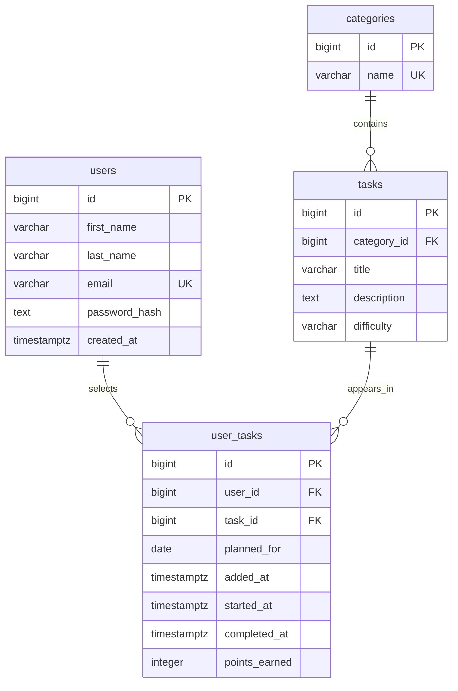

# Entity Relationship Diagram

The initial release uses four PostgreSQL tables. `user_tasks` connects users with predefined tasks and records individual scheduled task instances, timer state, and points.

## Relationship Summary

- **One-to-many:** One category contains many tasks.
- **Many-to-many:** One user can select many tasks; one catalog task can be selected by many users. The relationship is represented through `user_tasks`.
- **History:** Each row in `user_tasks` represents a user's selected task for a date. A user can select the same catalog task again on another date.

## Timer and Points Constraints

- At most one active timer per user.
- A task must be started before it can be completed.
- Points are assigned on completion using full elapsed minutes, capped at 120.
- The client does not submit its own authoritative point total.
